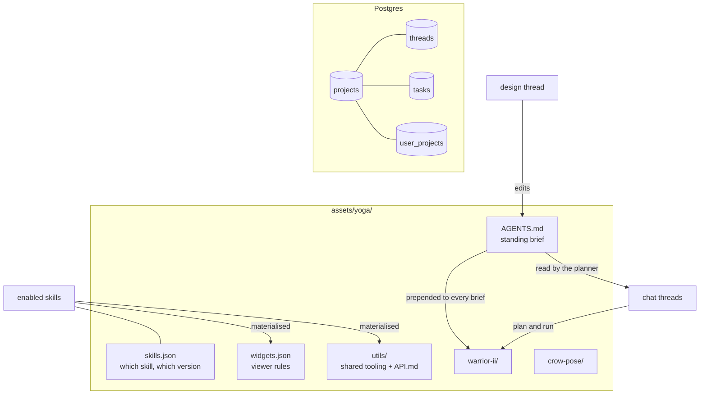
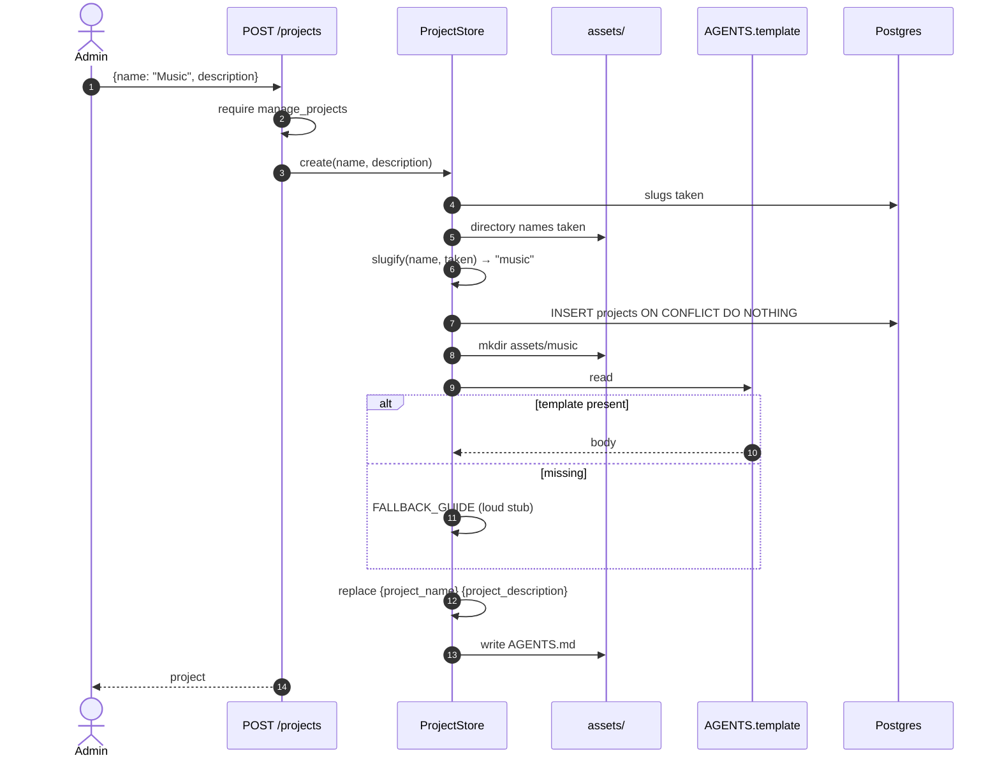
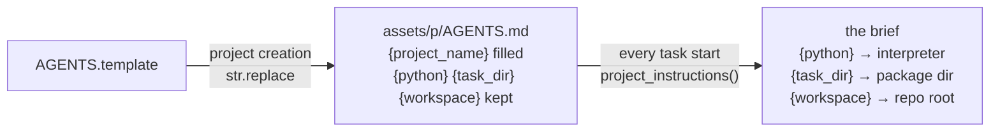
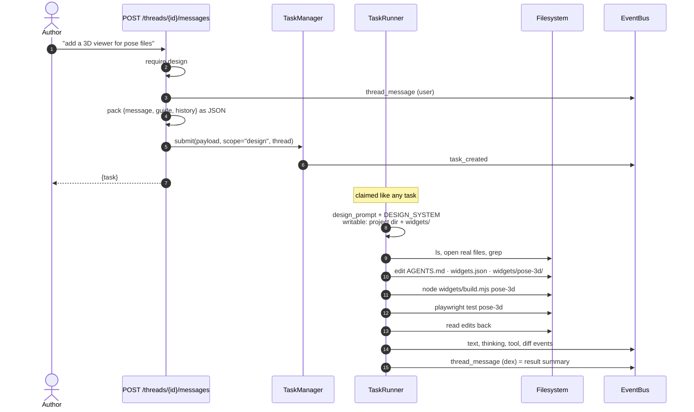
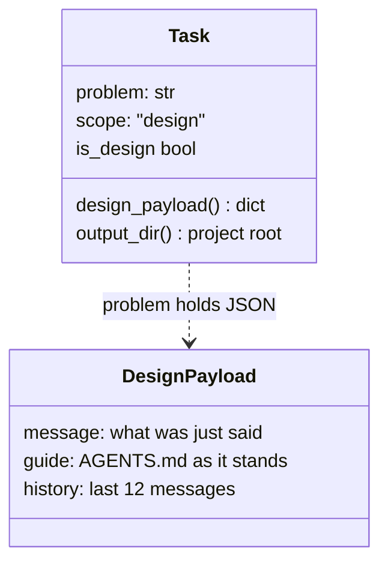
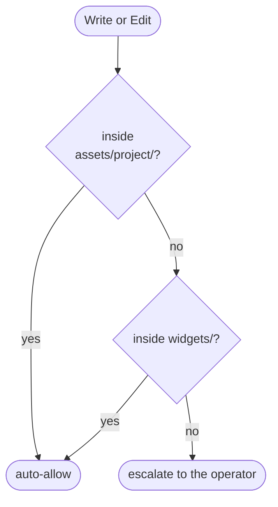
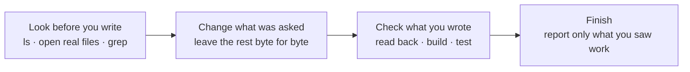

# 05 · Projects and the design chat

## Summary

A **project** is a named body of work: a directory under `assets/` holding a
standing brief, `AGENTS.md`, and one directory per package the project has
produced. The guide is what makes one dex serve unrelated kinds of work — algorithm
study packages, 3D yoga poses, music scores — without dex itself knowing about
any of them.

Each project has exactly one **design thread**: a conversation that shapes the
project rather than producing work in it. A turn in that thread runs as an
agentic task that can read the repository, edit the guide, author UI widgets,
build and test them, and report what it verified.

| Module | Responsibility |
|---|---|
| `src/dex/projects.py` | `ProjectStore`, seeding a guide from `AGENTS.template` |
| `src/dex/migrate.py` | `ensure_design_thread`, adopting a pre-project install |
| `src/dex/api.py` | Project routes, `_design_turn` |
| `src/dex/prompts.py` | `DESIGN_SYSTEM`, `design_prompt` |
| `src/dex/designer.py` | `history_text` for the design brief |
| `AGENTS.template` | The starter guide copied into every new project |

---

## What a project is

Only `AGENTS.md` and the task directories are the project's own. `utils/`,
`widgets.json` and `skills.json` are **materialised from the skills it has
enabled** ([15](15_skills.md)) — a new project has none of the three, and
nothing is wrong with that.

Switching project switches everything the UI shows — threads, tasks, feed,
library, guide — and the project is also the unit of access control
([01](01_auth.md)). Project directories live under the gitignored `assets/`, so
a clone starts with none.

---

## Creating a project

### Placeholders filled in two passes

Both passes use `str.replace`, not `str.format`. The template was once a
Python string passed through `.format()`, where every per-task placeholder had
to be written `{{python}}` to survive — and an edit that forgot was a crash at
project creation time.

The fallback guide is **deliberately loud**. A project with no guide makes every
task stop and ask what to build, so an empty file would be worse than a stub
that says why it is empty.

### What the template gives a new project

Twelve lines, and two of them are headings. Everything a task needs to know
that is *not* specific to this project — the environment, the operator's source
material, how a helper becomes shared — moved to `AGENTS.common.md`, which
every brief carries anyway; keeping a copy per project meant four copies of the
same 289 lines drifting apart ([15](15_skills.md)).

| Section | Purpose |
|---|---|
| `# Project: {project_name}` + description | Filled at creation |
| What to produce | Left for the design chat to fill in |
| Conventions | Left for the design chat to fill in |

### An unwritten guide says so

The template's body is addressed to the **operator**: *"Describe the
deliverable for a task in this project here."* A task handed that reads
instructions meant for somebody else as its specification, and builds whatever
the request on its own implies. That is worse than no guide, because it looks
like one.

So `untouched_template()` compares the guide against the template it was seeded
from, and a brief whose guide is still the starter carries a heading saying so
and sends the task to `mcp__dex__ask_user` — the same treatment a project with
no `AGENTS.md` at all gets.

The check is **derived from the template**, not keyed to a sentence copied out
of it: every line of prose the template ships with, still present and
unchanged, means nobody has written the guide. A check keyed to one phrase
would stop working the moment the template was edited, and stop silently.

### A new project has no skills

Nothing is enabled until somebody enables it in the admin list, which is the
right default — a skill is a capability, not a courtesy. Two consequences the
brief now states rather than leaving the task to discover:

- `utils/API.md` does not exist. The brief sends a task there to read what is
  shared; saying "there is nothing shared here yet" beats a task concluding the
  index is missing.
- There is nowhere to promote a helper to. The shared-utilities protocol
  describes a destination that does not exist yet, so the brief says to keep
  the helper local and name it in the summary instead.

---

## The design thread

`ensure_design_thread` runs whenever a project's threads are listed and creates
the thread the first time, with an opener message. It is idempotent: one
`project_design` thread per project, pinned above the chat threads.

### A design turn is a task

It used to be **a single tool-less call** that returned the whole guide back.
That could not author anything, could not check the files it described, and had
nothing to show while it worked. Running it as a task gives it tools *and* the
entire activity surface — streamed text, collapsed thinking, tool calls, diffs,
questions — because that surface belongs to tasks. What makes a turn a design
turn is only its brief and a wider write mandate.

> `designer.py` still contains the old one-shot `draft()` and `parse()`. Only
> `history_text()` is used now.

### Packing the conversation into one field

A task has one `problem` string; a design turn needs three things. They travel as
JSON in `problem` and are unpacked by `Task.design_payload()`:

Nullable columns for fields only one scope uses would be three empty columns on
every other row. A `problem` that is not JSON — a design task created before this
format — is read as the message on its own, which is still a usable turn.

Both halves of this — running a non-generation turn as a task, and packing its
several inputs into `problem` — were copied wholesale by the pre-planning
survey. See [14](14_survey_and_anchors.md).

### What the designer may touch

The brief names three things: `AGENTS.md`, `widgets.json`, and
`widgets/<name>/`. Writing anywhere else — another project, a package inside
this one, dex's own source — stops for approval, which the brief describes as a
sign the designer is somewhere it did not mean to be.

### The brief's working rules

"Look before you write" is the correction for the one-shot designer, which wrote
rules for a project it had never looked at. Reading is free and unrestricted, so
a couple of minutes of looking is the difference between a rule that fits and a
plausible one that does not.

### The reply lands in the thread

When the task's `ResultMessage` arrives, the runner appends its summary to the
design thread as a `dex` message. The thread reads as a conversation; the task
panel still holds the full run for anyone who wants the tool calls.

---

## Guides are gitignored

`assets/*` is gitignored, so **edits a design turn makes to a project's
`AGENTS.md` exist only on the machine that made them**. Only `AGENTS.template`
is tracked. An improvement worth giving every future project has to be made to
the template by hand.

---

## Adopting an older install

Before projects existed, packages sat directly under `assets/`.
`adopt_existing_project` runs at startup and registers the default project over
that layout, so an upgrade needs no manual step and no files move.

---

## Improvement opportunities

- **Nothing tells the operator their guide is unwritten.** A task reports it
  in a brief the operator never reads, and the design thread — the place that
  would fix it — says nothing when it opens on a starter guide.
- **A new project is created with no skills and no prompt to pick any.**
  Creation and enabling are separate screens, so the first task in a project
  routinely runs with nothing shared available to it.
- **The template is read at creation and never again.** The four guides on
  this install were trimmed by hand and share no substantial line with
  `AGENTS.common.md`, but nothing keeps that true: a project seeded from an
  older template would carry a duplicate copy of it, and no check would say
  so.
- **The design chat can author skills, and that path has never run live.**
  Fork, edit, test, publish is implemented and unit-tested, but no design turn
  has yet produced a skill end to end. The first one will be the real test of
  whether the instructions are followable.
- **Adopting a draft moves every project with no preview.** `adopt` publishes
  and re-materialises; nothing shows which projects are about to change before
  it happens, and the only record afterwards is a line in the thread.
- **A design turn is the one scope that may write to `skills/` itself**, which
  means it can create a directory that is not a skill. `publish` would then
  quietly ignore it.
