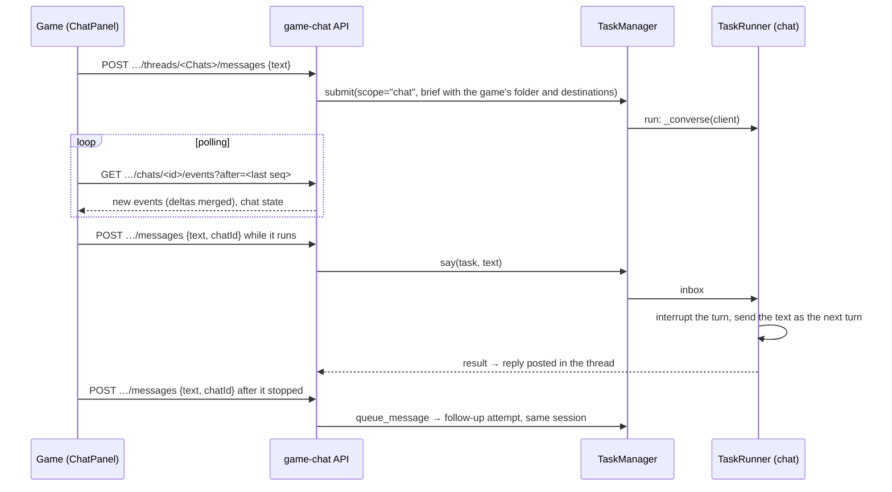

# 16 · Game chat

Module: `src/dex/game_chat.py` (routes, settings, CORS), with the chat loop in
`src/dex/runner.py` (`TaskRunner._converse`) and live delivery in
`src/dex/queue.py` (`TaskManager.say`).

A game talks to dex from inside the game. Its player types into a chat panel
(the engine's `ChatPanel` in `~/games`); the game sends the message to dex's
game-chat API, and dex answers by running a task in the game's project, in
that project's **Chats** thread. Many Builders talks to Games, Model Workshop
to ML.

## The pieces

- **A chat is a `chat`-scope task** (`Task.is_chat`), budgeted with the
  interactive pool so a reply does not wait behind generation work. Its brief
  (`chat_brief`) names the game, the game's folder, where each kind of asset
  goes there (from the game's `destinations`, kept inside the folder), what
  the player is looking at, and the message. The game folder is writable for
  it (`extra_writable`): it builds packages in its task directory, installs
  them with `catalog.export(pkg, game_root=…)` / `story.export_story`, and
  changes the game's code when the game needs it. A turn that only answers
  is a success (no empty-package failure). Its result is posted in the
  thread, as a design turn's is.
- **A conversation is a chain of attempts.** The first task's id is the
  chat's id; each message after the chat stopped starts the next attempt
  (`queue_message` → `deliver_messages`, resuming the agent session), worded
  for a chat ("The player replied"). Listing folds the attempts into one chat.
- **Talking to a running chat is not queued.** `TaskManager.say` puts the text
  on the live task's `inbox`; `_converse` interrupts the turn under way, waits
  for it to wind down, and sends the text as the next turn, so each message
  gets exactly one turn. Text that arrives after the last turn ended is kept
  as a follow-up note. A paused chat is cancelled and continued as a
  follow-up.
- **Polling, not streaming.** `GET …/chats/<id>/events?after=<seq>` returns the
  events of every attempt after `seq` (`after` absent or 0: the whole chat),
  at most 2,000 per page with `more`. Runs of text or thinking deltas for one
  block are merged into one delta, cost ticks collapse to the last, and long
  tool output is trimmed, so a poll carries what changed and little else.
- **Pause, resume, cancel** act on the chat's latest attempt.

## Auth and settings

Each project's chat has a token. `.dex/game-chat.json` (gitignored, re-read on
every request) holds per project `game`, `root`, `token` and `threadId`; the
routes take `Authorization: Bearer <token>` and refuse another project or
another thread. `GameChatCors` adds CORS for `/api/game-chat/` only (games are
served from other origins; the token is what protects the routes). Games reach
dex over the local network or the tailnet; a published claude.ai artifact
cannot (https page, http dex), so it shows no chat.

## Improvement opportunities

- **An interrupt cuts the agent off mid-step.** A message the player meant as
  "also, later" still stops the current tool call. A gentler mode would hand
  the message over at the next tool boundary.
- **Polling at one second while a chat runs** is simple and cheap for a
  handful of players, but an SSE stream per chat would be lighter for many.
- **The token is a shared secret in the game's `.env.local`.** Anyone with the
  dev build has it; rotate it by editing `.dex/game-chat.json`.
- **Questions and approvals are shown but not answered from the game.** With
  auto-approve on they resolve themselves; a question waits for dex's UI.

---

## See also

- [03](03_agent_runner.md) — the runner the chat loop lives in
- [02](02_task_lifecycle.md) — attempts, follow-ups, pause and cancel
- [07](07_event_stream.md) — the events a poll returns
