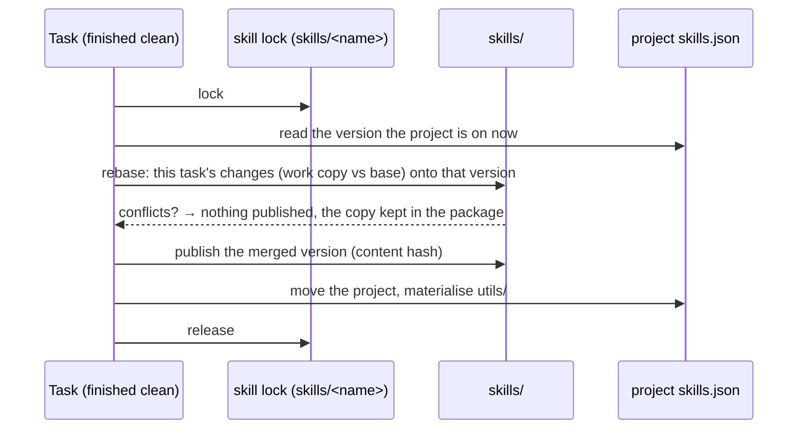
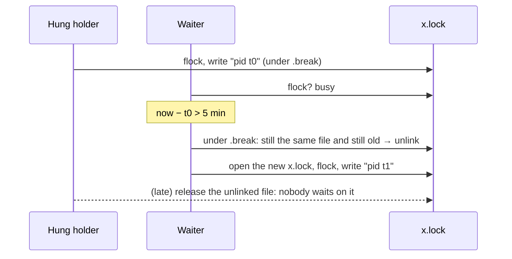

# 17 · Locked skill promotion and port leases

Several tasks run at once, and two kinds of shared state got lost between them:

- **Skills.** Each task promoted helpers by writing straight into the
  published version directory its project was on, so tasks on the same version
  shared one directory. At the end of each task, dex published that directory
  (renamed it to its new content hash) and restored the original. A task still
  writing then wrote into the restored original, and when it published, the
  project moved to a version without the first task's helpers. In one batch of
  45 lesson tasks this happened several times: `review.py`, `shots.py` and
  parts of `camfit.py` each disappeared from the project.
- **Ports.** Test tools picked "the first free port" by probing. Two runs
  starting together found the same port free, and one failed.

Both are read-modify-write. Each update now takes a lock, reads, writes, and
releases, in that order.



## Locks (`locks.py`)

`file_lock(path)` is a `threading.Lock` per path, for tasks inside the server
process, plus an `fcntl.flock` on the file, for scripts, the CLI and other
processes. It times out with `LockTimeout`, and the OS releases it if the
holder dies. `skill_lock(state_dir, name)` is the lock for one skill, kept in
`.dex/locks/skill-<name>.lock`.

**A lock held for more than 5 minutes is broken** (`STALE_S`, or a call's
`stale=`). Every real hold is seconds of reading and writing, so a longer one
means a holder that hung, or one a restart left behind. The next caller that
finds it so logs who held it, breaks it and takes it. A caller waits by
default long enough for that (`stale` plus a minute), so it gets the lock
rather than a `LockTimeout`.

- The thread lock is replaced with a fresh one; the stuck thread's late
  release only frees the old one.
- The lock file holds its holder's `pid time`, cleared on release. To break
  it the file is unlinked, so the stuck process keeps an flock on a file
  nobody opens, and the next open makes a new one. A small `.break` lock
  orders the holder's write of its time against a break, so a lock just
  taken is never broken on the previous holder's time, and a caller that
  locked a file someone unlinked meanwhile opens the new one and tries again.



## Skill promotion (`skills.work_copies`, `skills.promote`, `skills.rebase`)

1. **At task start**, the runner copies every enabled skill twice into
   `.dex/skill-work/<task>/`: a `base` copy (what the task started from) and a
   `work` copy. The prompt names the work copy, and only its `utils/` is
   writable. The shared versions are never writable by a generation task.
2. **At task end**, if the task finished clean, `promote` runs once per skill
   whose work copy differs from its base. Under the skill's lock it:
   - reads the version the project is on now;
   - rebases the task's changes onto it, file by file:
     - a file only the task changed takes the task's version;
     - a file only the other side changed keeps its version;
     - a file both changed gets a three-way line merge (`git merge-file`);
   - publishes the result as a new version (its content hash);
   - moves the project onto it and materialises `utils/`.
3. **A conflict**, the same lines changed on both sides, publishes nothing
   for that skill. The task's copy is kept in `<package>/promotion-conflicts/<name>/`,
   and the task's feed says so.
4. A run that did not finish clean promotes nothing, and its copies are deleted.

Promotion staging directories are dot-named (`skills/<name>/.promote-…`), so
nothing lists them as a version or as a draft while they are being built.

## Design turns (`skills.fork`, `skills.adopt`)

`fork` records the version a draft started from in `skills/<name>/.draft-base`.
`adopt` publishes each draft under that skill's lock. Before publishing, it
rebases the draft onto the newest version a project is on, if that version
moved on since the fork, so the tasks' promotions in between are kept. Where
both sides changed the same lines, the draft wins: the design turn is the
deliberate edit.

## Port leases (`ports.py`)

`ports.lease(state_dir, owner=…)` does a locked read of `.dex/ports.json`,
picks a port in 5400–5999 that is neither leased nor bindable by someone
else, records it with its holder's pid, and releases the lock.

A lease holds until one of these happens:
- `ports.release(state_dir, port)` gives it back;
- its holder process exits;
- it expires after six hours.

`with ports.leased(...) as port:` covers the common case. From any language:

```bash
python -m dex.ports lease --owner story-e2e
python -m dex.ports release 5412
python -m dex.ports list
```

A lease made through the CLI belongs to the caller's parent process, so it
ends when that process exits.

The game-story skill leases a port for every end-to-end run it starts.

## Improvement opportunities

- **A broken holder is not told.** A holder that was only slow, not stuck,
  goes on and writes after its lock was broken, racing the new holder. A
  long hold could renew its time (a heartbeat), or check before writing that
  its file is still the one at the path.

- **Locks are advisory.** A task can still write into a shared version from
  its own shell; only the permission policy keeps it out, and only by default.
- **A conflict needs a person.** A three-way line merge is all dex does. Two
  tasks editing the same function in different ways leave one copy in
  `promotion-conflicts/` for someone to reconcile.
- **Merges are line-based.** Two edits on neighbouring lines of the same
  function merge cleanly but may not fit together. The skill's own tests,
  which the next task runs, are what catches that.
- **The engine's story-e2e tool scans for its own port** unless it is given
  `--port`, so a direct call outside the skill can still race. It could lease
  through `python -m dex.ports` itself.
- **Leases are local.** They live in one state directory, so two dex installs
  on one machine do not see each other's.
