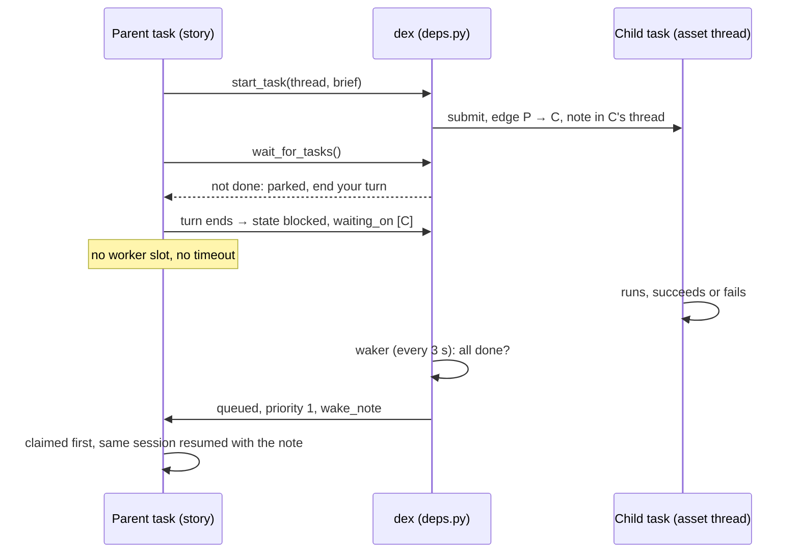
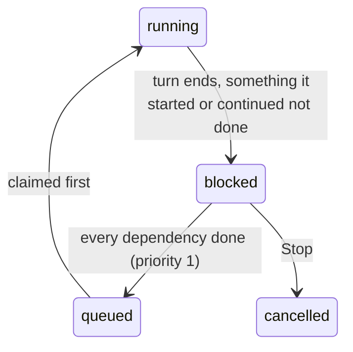

# 18 · Task dependencies and the task graph

Module: `src/dex/deps.py` (`Dependencies`), with `DepStore` in `store.py`, the
agent's tools in `runner.py` (`_task_tools`) and the view in
`web/src/components/TaskGraph.tsx`.

## Why

A game's assets and its stories depend on each other. How much a lesson can
show is limited by the models, props and sounds the game has; a chat in the
game is asked for a change that belongs to an asset made in another thread.
Before this, a task could only work inside its own package. Anything it
needed from elsewhere had to wait for a person to start it by hand, and the
task meanwhile either worked round the gap or finished without it.

Now a task can start or continue the work it needs, in the thread where that
work belongs, and wait for it. Every such link is an edge in a DAG of tasks,
and the top bar's **Task graph** button shows the live part of it.

## The tools

Every task except a survey gets them, in the in-process `dex` MCP server
beside `ask_user`:

| Tool | Does |
|---|---|
| `project_threads` | Lists the project's threads (asset work has one per kind of asset). |
| `find_tasks(query, thread?)` | Finds existing tasks by words in title, slug, package or brief: one entry per package, its latest attempt. |
| `start_task(thread, title, brief, slug?, create_thread?)` | Starts a new task in a thread of the same project. The thread records who asked. |
| `continue_task(task, message)` | Asks an existing task for a change: a follow-up note to its latest attempt (`queue_message`), which becomes a new attempt in the same package. |
| `task_status(tasks?)` | Where tasks stand now: state, done, package directory, summary or error. |
| `wait_for_tasks(tasks?, wait_s?)` | Waits up to `wait_s` (≤ 300 s) in the turn, then parks the task as **blocked** (below). |

`start_task` and `continue_task` record an edge: the task **depends on** the
one it started or continued. `wait_for_tasks` records one for every task it
waits on. The tools' own descriptions tell the agent to be judicious: look
first, continue rather than duplicate, write a brief that stands on its own,
and remember that every task spends the operator's usage. The game-story
skill and the ML project's guide say when a story should and should not ask
for an asset.

Refused, with the reason returned to the agent:

- **a cycle**: depending on a task that already waits for this one, directly
  or through others, or on its own package;
- **too deep**: a task `MAX_DEPTH` (3) levels below a waiter may not start more;
- **too many**: one task may start or continue at most `MAX_DEPS` (8);
- another project, an unknown thread (unless `create_thread`), an empty brief.

### Asset work always goes to its own task, in its own thread

- **A chat never makes or edits an asset or a story.** Its brief says so, and
  the permission policy enforces it (`PermissionPolicy(delegate_assets=True)`
  for chat tasks): it refuses package files in the chat's own directory
  (`manifest.json`, `story.json`, `e2e.json`, models, sounds), any write into
  the game's installed assets, and shell commands that build, copy or install
  a package, except the game's own puller. The chat changes an existing one
  with `continue_task` (its task lives in its thread) or starts a new one with
  `start_task`.
- **`start_task` picks the right thread.** It needs a slug with its type
  prefix (`dataviz-`, `story-`, …), and refuses a thread other than the one
  most packages of that prefix were made in (`Dependencies.home_thread`,
  when there are at least two). A prefix with no home yet may go anywhere.

### A new set of lessons: the catalog first

A game's lessons are listed in its story catalog (kind `catalog`, the
`game-catalog` skill, in the project's Catalog thread). A chat or story task
asked for a new set of lessons first continues (or starts) the catalog task
with the new section or tiles as placeholders and waits for it; the chat
pulls it, so the game shows the set as coming soon; only then does it start
one story task per lesson, each naming its `story/<name>` from the catalog.
The chat brief, the game-story skill and the project brief all say so; a
tile goes live in the game when its story is pulled, with no second catalog
change. A chat may not write `catalog.json` itself (`PACKAGE_FILES`).

## Done follows the chain

An edge points at the attempt it was made to, but attempts chain (`parent_id`)
and a follow-up continues the same package. So a dependency's state is its
**latest attempt's**, and it is **done** when that attempt has ended
(succeeded, failed, cancelled or archived) and no follow-up note is still
queued for it. A note queued on a running task keeps it not-done until the
attempt that note starts has finished too.

## Blocked: waiting without holding anything

- **A task is not done before what it asked for is.** When a turn ends while
  anything the task started, continued or waits on is not done, the run is
  recorded **blocked** instead of judged, whether or not it called
  `wait_for_tasks` (which only parks it sooner, telling it to end its turn).
  Skill promotion waits, and the empty-package rule is applied to both halves:
  a woken run that only reviews passes if the run before it wrote the package
  (its `blocked` event records `wrote`).
- **Chats and design turns too.** Their last message before blocking tells the
  person what they wait for; woken, they check the result, finish, and say
  so. A game chat finishes by pulling exactly the packages it asked for into
  its game with the game's own puller (`pull_dex_assets.py <game> --only
  <task-dir>`, from `game_chat.pull_command`), so they get the game's checks
  (validation, a story's passing in-game test) and nothing else that happens
  to be ready comes along. A message the person sends while one
  is blocked is held and starts the next attempt once it has finished.
- A blocked task holds **no worker slot** and **no timeout runs**: its run
  ended. The next run, after waking, gets the full `task_timeout_s` again.
  This is what keeps the queue from deadlocking: with six slots, six parents
  each blocking in-turn would leave no slot for the children they wait on.
- Its working copies of skills (doc 17) are kept, and reused on resume when
  the skill version has not moved.
- Shown with an orange dot (dex) and 🟠 *Waiting on other tasks* (a game's chat panel).
- The **waker** checks blocked tasks every `WAKE_EVERY_S` (3 s). When all a
  task waits on are done, it is queued with `priority` 1, `resumed_from` its
  session, and a `wake_note` listing each dependency: state, summary or
  error, package directory. `claim` orders by priority first, so a woken
  task goes before all other queued work; claiming resets the priority.
- The resumed session is sent only the note (it already has the brief). If the
  session cannot be resumed, the fresh one gets the brief and the note.
- A failed or cancelled dependency still wakes its waiter: the note says so,
  and the waiter decides (a `continue_task`, or a way round it).

## Run options pass down

A task carries `options`, set by whoever started it; today one, `e2e`. A game
chat sets it from its panel's **E2E tests** switch (`context.e2e`). With
`{"e2e": false}` the runner appends a note to the brief (skip end-to-end
tests and their reports; every other check stays) and sets `DEX_SKIP_E2E=1`
in the agent's environment, and a game chat pulls with `--allow-untested`.

The options pass down the graph: `start_task` gives the new task the
waiter's (`deps.INHERITED`), and `continue_task` queues its note with them,
so the attempt that note starts runs the same way (`task_messages.options`,
merged by `deliver_messages`). A message a player sends to a running chat
updates that chat's options for what it starts from then on.

## The task graph view

`GET /api/dag?project=` returns the active part of the graph. A node is a task
**chain** (all attempts of one package) drawn as its latest attempt. Shown:

- every chain that is queued, running, awaiting input, paused or blocked,
  whether or not it has edges (isolated nodes are fine);
- finished chains joined by an edge to an active one;
- finished chains that took part in an edge and ended in the last 6 hours.

The top bar's 🕸 button opens it. The view redraws every few seconds as a
Mermaid flowchart: an edge runs from the task that waits to the one it waits
on, nodes are coloured by state, and each names its thread. Clicking a node
opens the task.

## Improvement opportunities

- **The planner cannot route tasks to other threads.** A plan's tasks all
  land in the thread it was made in; asset tasks a planning chat proposes
  could go straight to their asset threads.
- **No budget per graph.** The limits count tasks, not dollars; a graph could
  carry a spending cap that a child's cost counts against.
- **Waking polls.** Every 3 s is cheap at this scale; a task_state event could
  wake the waiter at once instead.
- **One project only.** A game whose assets live in another project cannot
  depend on them.
- **The view is per project and redraws whole.** Fine for tens of nodes; a
  large graph would want incremental layout.
