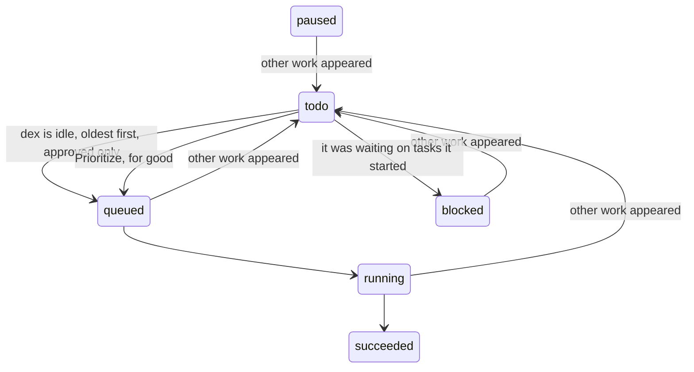
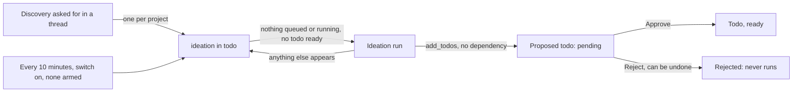

# 24. Todos and ideation: work that waits for dex to be idle

A request can be marked as not urgent. Instead of running now it becomes a few
todos, each with a spec, which run one at a time whenever dex has nothing else
to do and give way the moment it does. Behind them, a project can have one
ideation task, which fills idle time by proposing todos for the operator to
approve. `src/dex/todos.py` is all of it, driven by a loop.

**Splitting.** A game chat with Todo ticked starts a task of scope `todos`: a run
on the planner's model, in the chat pool so it starts at once. It scouts with
read-only tools and calls `add_todos`. A run that adds nothing fails. There is no
plan to approve: ticking the box was the approval.

**Todos** are power tasks in the project's Power thread, created in state `todo`,
each in its own directory with a `SPEC.md` written from what the chat found.
Workers only claim `queued`, so nothing else has to know about them. The Library
lists them like any package, newest activity first, and opens the spec.

**Tags.** dex keeps one `todo:*` tag in each todo's manifest from
`options["approval"]` and its state: `todo:pending-approval`, `todo:approved`,
`todo:rejected`, `todo:done`. The manifest is a mirror for the Library's filters;
the row decides.

dex also adds tags it works out when listing, from the tasks behind a package, and
never writes them to a manifest: `origin:chat` for what a game chat or its todo
split made, `origin:ideation` for every todo and proposal. Tags are `group:value`
because the group is what the Library's filters are built from. A chat's directory often holds no
package, and one that does may be installed in a game, where a manifest change
would count as a changed package. So old chats have the tag too.

**The family.** `options["todo"]` marks a todo, and `INHERITED` hands it to
whatever a task starts or continues, so spawned tasks are in the family however
deep they go. A todo may start tasks, unlike other power tasks: that is what
makes it worth splitting work this way.

**Regular work** is anything outside a family that is `queued`, `running`, or
`paused` and will start again by itself. A task waiting on the operator or on
other tasks runs nothing, so it doesn't count; when it runs again it does. A
`todos` run doesn't count either: splitting a request must not stop the list.

**Going back.** Each tick with regular work sends every family member that is in
flight to `todo`, keeping its session in `resumed_from` and what it waits for in
`waiting_on`. A running one is stopped like any pause, and records that pause on
its way out, after the move, so the next tick finds it paused and moves it again.
The loop polls because tasks also arrive straight in the database from
`scripts/enqueue_task.py`; `submit` only wakes it sooner.

**Resuming.** With nothing regular left, a family member that was waiting on
tasks goes back to `blocked`, and the first with nothing to wait for is queued.
Only one starts per tick, and none while a family member is running. One the
operator paused holds nothing up.

**Prioritize** removes `options["todo"]` from the task and everything under it,
queues it and raises it. It is regular work from then on: it can't go back, and
the family gives way to it. A proposal has to be approved first.

## Ideation

**One per project.** Scope `ideation`, in a project with the Power skill enabled,
always in its Power thread, which dex makes when the skill is added.
`start_discovery` (chats and design turns, or `POST /api/projects/<slug>/ideation`)
refuses while one exists, paused or not. `force` cancels that one and starts a
new one now, as regular work.

**The switch.** Settings shows Ideation for the open project if it has the Power
skill, off until someone turns it on. It is stored per project (`ideation:<slug>`
in `settings`). Off pauses the armed task, on resumes it or starts one. Removing
the skill turns it off, and adding the skill again leaves it off. Asking for
discovery turns it on; `force` runs one step and leaves it as it is.

**The timer.** Every 10 minutes the loop looks at each project with the switch on
and adds a task if it has none that hasn't ended, and otherwise does nothing. A
task doesn't arrange its successor: this timer is the only thing that does. So
after a run ends the next one comes within 10 minutes, a project gets at most six
new runs an hour, and cancelling or failing ends that run only, not the cycle.
Only the switch ends the cycle.

**Its turn.** It is a family member that starts last: only with no regular work,
no approved todo waiting and no todo in flight, oldest first, so projects take
turns. Anything else appearing sends it back like a todo. A proposal waiting for
approval, or rejected, doesn't count as waiting.

**The run** is on the planner's model, may write only its own directory, and
never asks: every approval is granted unasked (`_escalate`), whatever the
auto-approve toggle says. Refused before that (`unattended` in `permissions.py`):
writes outside its directory, other packages, and what a power task may never run,
such as `sudo`, pm2 or a force-push. Its brief rules out changing things by
command, which is an instruction and not a check. It can read the database with
`query_database`. A `todos` run stays stricter: what would need approval is refused. Every run works in `ideas/<project>/`, beside `assets/`, whose
`IDEAS.md` is its log of what it tested and proposed, so the next run looks
somewhere else. The log is one line per thing, newest first: `log_idea` adds
`- <UTC time> <text>` at the top, cut to 200 characters. dex adds proposals and
the operator's decisions itself, so a line can't be forgotten or misdated, and
the file stays quick to read however long the cycle runs.

**Proposals** are todos with `options["proposed"]`, `approval: pending`, and no
dependency edge: the run doesn't wait for them. `add_todos` refuses one without
`code_lines` and `asset_lines`, the run's upper bounds. dex writes them at the top
of its `SPEC.md` and tags it with the smallest power of ten that bounds each,
capped at 6: `code-lines:0c` to `6c`, and `asset-lines:0a` to `6a`. Each has a directory in
`ideas/<project>/`, not in the project's assets. Approve and Reject are offered on
the task and beside the spec until the todo starts, and either can be undone.

**Reaching ideas.** The Library's Ideas side lists the log and the proposals, with
the same Arrange as the assets, remembered apart because the tags differ, and
asset routes read `ideas/<project>/...` for the operator. Of the tasks, only power
and ideation may: for the rest `permissions.py` refuses paths in `ideas/`, and
commands naming its absolute path. A command that builds the path some other way
gets past that check, as with package writes.

## Improvement opportunities

- **A stopped run loses its turn.** Going back cancels a run mid-turn, and its
  session resumes from the last message; a todo could finish its turn if the
  regular work is small.
- **One at a time, always.** Unrelated todos could share idle time; one at a
  time is simply the safe answer for code changes in the same checkouts.
- **Only game chats start a list.** dex's own threads and `enqueue_task.py` have
  no way to ask for one yet.
- **Ideation has no budget.** The timer limits how often it starts, not what it
  spends. A daily spend limit or a cap on unreviewed proposals would bound it.
- **The Library's order is read when it opens.** A task finishing doesn't move its
  row until the Library is opened again.

## Ideation changes nothing: enforced, not asked

An ideation task proposes; only an approved todo changes code. Its commands are
approved unasked, and what a command writes can't be read off it, so the rule is
the kernel's (`src/dex/sandbox.py`). Every shell command runs in `sandbox-exec`:

| | Ideation may | Refused |
|---|---|---|
| Write | `.md` files directly in `ideas/<project>/`, and a scratch directory | everything else, a todo's directory included: a spec does not change after approval |
| Network | localhost 4400-4499 | the running dex, Postgres, anything else: it cannot approve its own todo |
| Propose | `add_todos`, always pending approval | starting work |

Vite's caches (`node_modules/.vite*`) are writable too, or a game could not start.

**What a run does.** A run that only re-runs passing suites finds nothing, so the
brief has it use what the project made: play a random story in the game with
`story-e2e --out $TMPDIR/...`, drive the app, test assets end to end, read a
lesson as a learner would, or query the task history. Every run proposes one to
three todos; "everything is healthy" sends it to look at something else.

The `Write` and `Edit` tools are held to the same paths by `permissions.py`.
With no `sandbox-exec` (Linux) ideation gets no shell, rather than an unconfined one.
