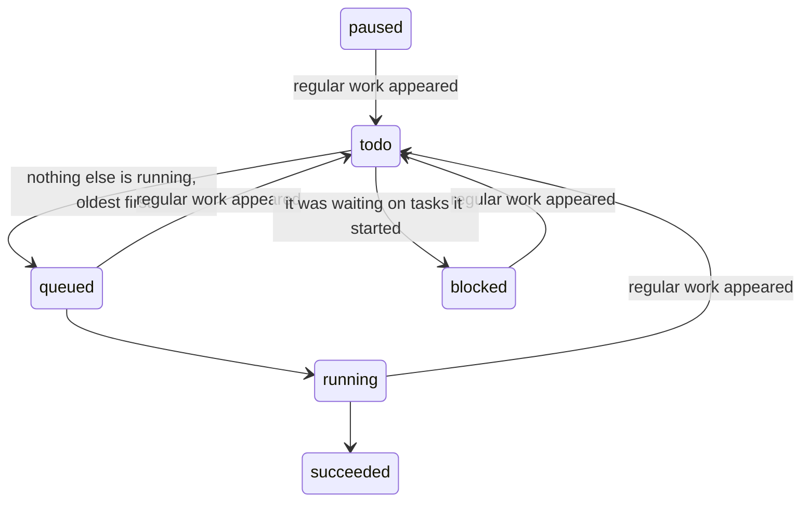

# 24. Todos: work that waits for dex to be idle

A request can be marked as not urgent. Instead of running now it becomes a short
list of todos, which run one at a time whenever dex has nothing else to do, and
give way the moment it does. `src/dex/todos.py` is all of it, driven by a loop.

**Splitting.** A game chat with Todo ticked starts a task of scope `todos`: a
short run on the planner's model, in the chat pool so it starts at once, with
one tool, `add_todos`. Its directory is the list's home, and it finishes when
the list exists. A run that adds nothing fails.

**Todos** are power tasks in the project's Power thread, created in state `todo`.
Workers only claim `queued`, so nothing else has to know about them.

**The family.** `options["todo"]` marks a todo, and `INHERITED` hands it to
whatever a task starts or continues, so spawned tasks are in the family however
deep they go. A todo may start tasks, unlike other power tasks: that is what
makes it worth splitting work this way.

**Regular work** is anything outside a family that is `queued`, `running`, or
`paused` and will start again by itself. A task waiting on the operator or on
other tasks runs nothing, so it doesn't count; when it runs again it does. A
`todos` run doesn't count either: splitting a request must not stop the list.

**Going back.** Each tick with regular work sends every family member that is in
flight to `todo`, keeping its session in `resumed_from` and what it waits for in
`waiting_on`. A running one is stopped like any pause, and records that pause on
its way out, after the move, so the next tick finds it paused and moves it again.
The loop polls because tasks also arrive straight in the database from
`scripts/enqueue_task.py`; `submit` only wakes it sooner.

**Resuming.** With nothing regular left, a family member that was waiting on
tasks goes back to `blocked`, and the first with nothing to wait for is queued.
Only one starts per tick, and none while a family member is running.

**Status.** The loop keeps `todos.json` in the list's directory current, and the
file watcher tells open viewers. The `power` skill's `power-todos` widget reads it.

## Improvement opportunities

- **A stopped run loses its turn.** Going back cancels a run mid-turn, and its
  session resumes from the last message; a todo could finish its turn if the
  regular work is small.
- **One at a time, always.** Unrelated todos could share idle time; one at a
  time is simply the safe answer for code changes in the same checkouts.
- **Only game chats start a list.** dex's own threads and `enqueue_task.py` have
  no way to ask for one yet.
- **The status file is rewritten by polling.** Every 3 s is cheap, and a
  task_state event could do it at once.
