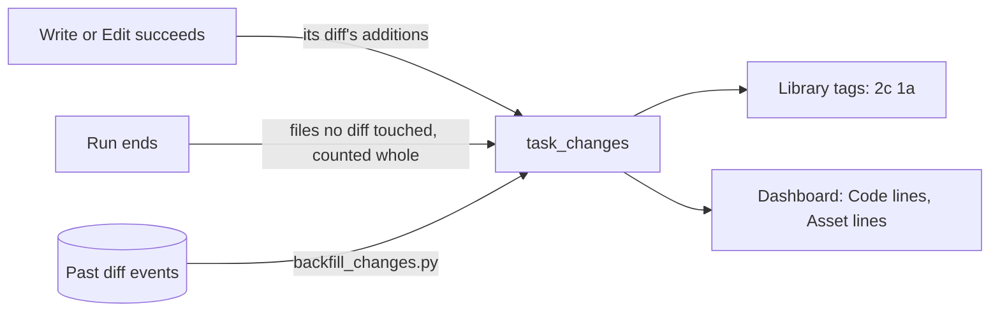

# 25. Line changes: what a task changed, in code and in assets

Every task keeps a running count of the lines it added or modified, split into
code and assets, in `task_changes`. `src/dex/changes.py` holds the rules.

**What counts.** Added and modified lines, never removed ones. A file with a known
code or documentation extension is code, so `.py` and `.md` are; anything else is
an asset, so `.json`, `.yaml` and `.csv` are, which puts a story's `story.json` on
the asset side. Binary files have no lines. dex's own state, `.claude`,
`node_modules` and the like don't count.

**While a task runs.** dex builds a diff before each Write or Edit, and adds its
lines when the tool succeeds, so a refused write counts for nothing. Bash can write
too, and has no diff, so when a run ends each file in its package that changed and
no diff explains is counted whole. For a file that already existed that overstates
the change: dex doesn't keep the old copy. Files a command writes outside the
package are not seen, so power tasks working by script undercount.

**Tags.** A package's lines are the sum of its tasks', and it shows the smallest
power of ten that bounds each, capped at 6: `code-lines:0c` to `code-lines:6c`,
`asset-lines:0a` to `asset-lines:6a`, so the Library's filters list them as two
groups. A package with no lines reads `0c`. Like `chat`, they are worked out when listing and never
written to a manifest, because a manifest change counts as a changed package in a
game's pull. A proposed todo starts with its estimate in its manifest (design/24);
as soon as it has a row of its own, the actual tags replace the estimate.

**The dashboard** has Code lines and Asset lines beside Cost and Tokens: the sum of
lines per period, stacked by the chosen group. `task_changes` keeps a total per
task, so a task's lines land when it last did anything, and under the skill it
spent the most on.

**History.** `scripts/backfill_changes.py` counts past tasks from their `diff`
events, leaving out what the tool refused, and gives files no diff touched to the
package's first task. It only ever adds a task with no row, and marks it `inferred`.

## Improvement opportunities

- **Bash writes are seen late and whole.** Keeping a package's text at the start of
  a run would let the end of the run diff it properly.
- **Attribution of scripted files.** History can't say which task's script wrote a
  file, so a package's first task gets them.
- **A package with no surviving task** has no row, so no tags.
- **Lines per task, not per hour.** A long task's lines all land at its end; an
  hourly rollup like `task_usage` would place them properly.
