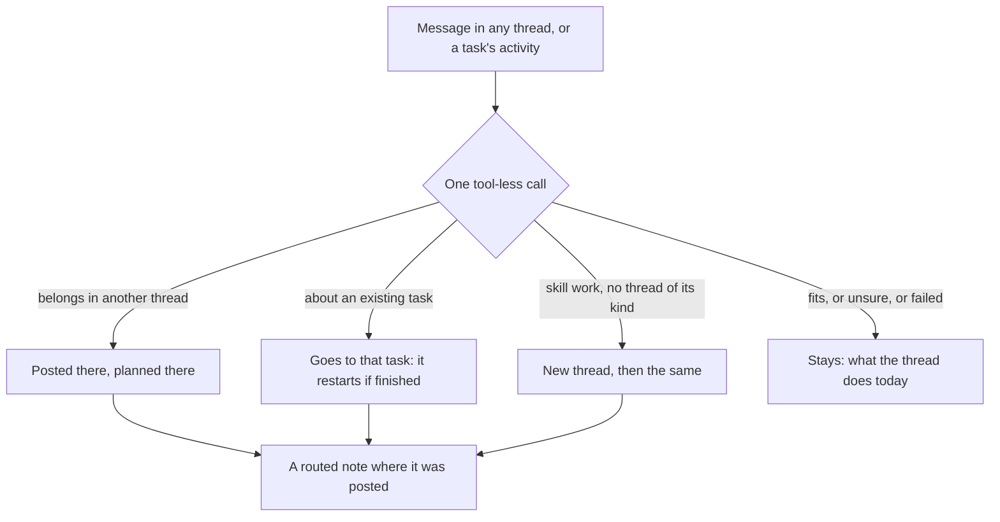
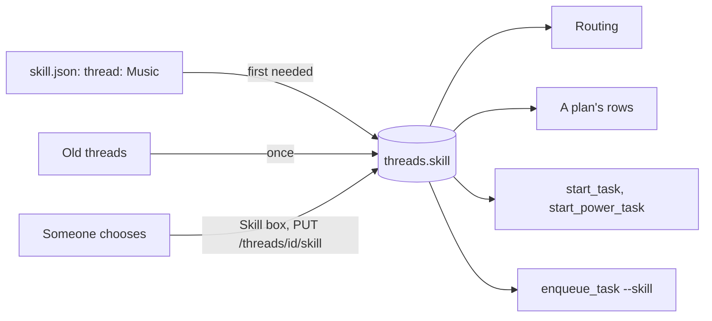

# 26. One chat: every message goes where it belongs

People were confused by where to post. The design thread ran no tasks, a thread
didn't restart a related task, and a task's activity continued that task when the
request was new work. So each project has one **Main** thread to post in, and a
message is routed wherever it is posted. `src/dex/router.py` is the decision;
`post_message` and `post_task_message` in `api.py` carry it out.

**Three intents.** `design` shapes the project, `skill` is what a skill's thread holds,
and `task` is everything else. The thread decides (`intent_of`), from its tie. A
task's intent is its thread's. It is never stored, so old threads and tasks have one
too, and it reaches the Library as an `intent:*` tag, worked out when listing.

**The router** sees the guide, the skills, the threads and the 40 latest tasks that
nothing has continued, and answers in JSON. It is held to what it was shown: an id it
made up is ignored. It names a skill, and can't name a thread that doesn't exist, so
it can't make one. Anything that fails leaves the message where it was posted. A user
who may not design, or may not run tasks, isn't routed there.

## Threads tied to skills

Other chat apps grow a thread per request. Here a thread is a place for one kind of
work, and the skill is what says so.

**The tie.** `threads.skill` names the skill; nothing is worked out from a title. A
tied thread is `skill` intent, and any other chat thread is `task`.

**Declaring.** A skill says in its `skill.json` which thread it keeps: `"thread":
"Music"`. That file is outside the version hash, so this needs no new version, and a
project's pin stays. `"base": true` marks a skill that others build on (game-mesh).
Power and the game skills declare one. A skill with none has no thread of its own.

**One rule makes threads.** `Dependencies.skill_thread` is the only place dex does
it: when a skill that declares a thread needs one and has none tied. A thread with
that title is tied rather than duplicated. So threads appear only as work reaches
them, and a project never has two for the same reason. Tasks can't name a new thread:
`start_task` has no such option. A person still can, with New thread, and
`enqueue_task --create-thread` still can from a script.

**Several threads, one skill.** Players and Enemies are both game-characters. Work goes
to the busiest unless the router or the task picks another of those tied.

**Delegating.** A task's dependency names the skill that makes it, and runs in that
skill's thread however deep it is; a power task always runs in Power. A plan's rows name
theirs too, so a request in Main fans out: the rows start in their threads, Main shows
all of them, and each thread says where they came from. So the main task stays in one
place and its parts sit with their kind.

**Old threads** are tied once for each project, when its threads are first listed:
by the title a skill declares, or else by what the thread's tasks used, a specific
skill before a base one, if it was at least a quarter of them. Main, Chats and threads
of no skill stay untied. `settings` records that it ran (`threads_tied:<project>`), so a
tie someone changes stays changed.

**Fixes for each confusion:**

| Posted in | Now |
|---|---|
| The design thread | Work leaves for its thread, or Main: only design stays |
| A thread, about a task | The task gets it, and restarts if it had stopped |
| A task's activity | That task keeps it only if it is about that task. New work (`new_task`) is planned in the right thread, and the panel follows it |

Activity of chats, surveys, ideation and todo splits isn't routed: it is that
conversation. A plan of one task from someone's message starts at once; larger ones wait for Run. Game chats have their own route (16).

**The menu.** The project picker heads the sidebar. Under it a scrolling list names
every place, with its icon: Home, Library, Ideas (with the Power skill), Task graph, Guide, Chat, Review
feed, then costs, skills, users and the account. Chat holds New thread and the threads, one line each, and clicking it folds them. Settings is pinned to the bottom. On a phone the sidebar is a drawer, and ☰ stays in the corner to open and
close it, with a dot when something is unread. Notifications float in the top-right
corner of every screen, over the panes. A pane has no ✕: its ‹, or the menu, leaves it.

**The UI.** Main opens first and can't be hidden. Dex posts a `routed` message that
links to where it went. From Main you stay, to keep delegating; anywhere else you are
taken there. The Library arranges by `intent`.

## Improvement opportunities

- **Every message costs a call**, even in the thread it belongs in, and waits for it.
- **A wrong move has no undo.** The note says where it went; someone has to post it again.
