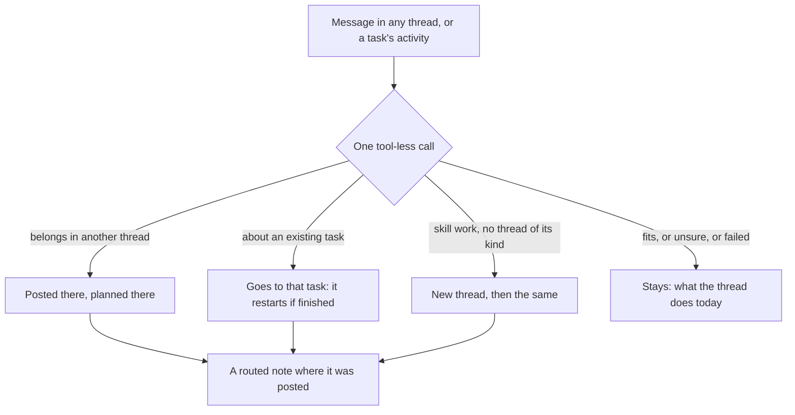

# 26. One chat: every message goes where it belongs

People were confused by where to post. The design thread ran no tasks, a thread
didn't restart a related task, and a task's activity continued that task when the
request was new work. So each project has one **Main** thread to post in, and a
message is routed wherever it is posted. `src/dex/router.py` is the decision;
`post_message` and `post_task_message` in `api.py` carry it out.

**Three intents.** `design` shapes the project, `skill` makes one kind of asset, and
`task` is everything else. The thread decides (`intent_of`): the design thread is
`design`; Main, Chats and Power are `task`; any other chat thread is `skill`. A
task's intent is its thread's. It is never stored, so old threads and tasks have one
too, and it reaches the Library as an `intent:*` tag, worked out when listing.

**The router** sees the guide, the skills, the threads and the 40 latest tasks that
nothing has continued, and answers in JSON. It is held to what it was shown: an id it
made up is ignored, and a thread whose intent disagrees isn't used, which is what
keeps design and skills apart. It makes a thread only for skill work, and only from
a thread that isn't one. Anything that fails leaves the message where it was posted.
A user who may not design, or may not run tasks, isn't routed there.

**Fixes for each confusion:**

| Posted in | Now |
|---|---|
| The design thread | Work leaves for its thread, or Main: only design stays |
| A thread, about a task | The task gets it, and restarts if it had stopped |
| A task's activity | That task keeps it only if it is about that task. New work (`new_task`) is planned in the right thread, and the panel follows it |

Activity of chats, surveys, ideation and todo splits isn't routed: it is that
conversation. Plans still wait for Run. Game chats have their own route (16).

**The menu.** The project picker heads the sidebar. Under it a scrolling list names
every place, with its icon: Home, Library, Task graph, Notifications, Guide, Chat, Review
feed, then costs, skills, users and the account. Chat holds New thread, the filter and
the threads, one line each, and clicking it folds them. Settings is pinned to the bottom. On a phone the sidebar is a drawer, and ☰ stays in the corner to open and
close it, with a dot when something is unread.

**The UI.** Main opens first and can't be hidden. Dex posts a `routed` message that
links to where it went. From Main you stay, to keep delegating; anywhere else you are
taken there. All, Design, Skills and Tasks filter the thread list and the task graph,
remembered per browser; Main always shows. The Library arranges by `intent`.

## Improvement opportunities

- **Every message costs a call**, even in the thread it belongs in, and waits for it.
- **A wrong move has no undo.** The note says where it went; someone has to post it again.
- **The review feed isn't filtered:** it lists topics, not tasks.
