# 30 · A task agent's context window

## Summary

Everything a task's agent knows is what is in its context window: what the
harness put there before the first token, what dex put in the brief, what each
tool call read back, and what was summarised away. This document draws that
window for the five situations that change it:

1. [a task starting](#1-a-task-starts) — system prompt, dex's instructions,
   the project guide, the skills list, the brief, the tools;
2. [a session resuming](#2-a-session-resumes) — a pause, a follow-up, a wake,
   a lost session, a message typed mid-run;
3. [skills read mid-run](#3-skills-pulled-in-mid-run) — a `SKILL.md`, a
   skill's files, `utils/API.md`;
4. [a tool call](#4-how-a-tool-call-runs) — call → policy → result, and
   subagents;
5. [summaries](#5-summaries-and-compaction) — the closing summary, dex's
   `/compact`, a fresh session from a summary, and an agent compacting itself
   when the window fills.

Each situation has a **sequence** (who adds what, in order) and a **block
diagram** of the window as stacked blocks, oldest at the top. Every block
names what it holds and the function that puts it there.

dex runs four kinds of agent. They share one runner (`TaskRunner.run`, in
`src/dex/runner.py`), one brief (`src/dex/prompts.py`) and one permission
policy (`src/dex/permissions.py`); they differ in who owns the system prompt,
where dex's own instructions land, how tool calls reach the policy and what
happens when the window fills.

| Agent | Model id | Client (`TaskRunner._client`) | Process | Session |
|---|---|---|---|---|
| Claude | `claude-…` | `ClaudeSDKClient` (Agent SDK) | Claude Code CLI over stdio, one per run | session id, resumed with `resume=` |
| Codex | `codex:<model>#<effort>` | `codex.CodexClient` (design 29) | `codex app-server`, JSON-RPC, one per run | a thread, `thread/resume` |
| OpenCode | `oc:<model>` (Go plan), `oc:local/<id>` (this Mac or Colab) | `opencode.OpencodeClient` (design 28) | `opencode run`, **one process per turn** | `ses_…`, `--session` |
| Antigravity | `agy:<model>` | `antigravity.AgyClient` (design 27) | `agy` print mode, stream-json, one per run | a conversation, `--conversation` |

A local model (`oc:local/…`) is OpenCode with one more hop: its requests go
through dex's relay (`antigravity.Bridge._relay`) to the model server, which
is how dex streams its tokens and keeps its prompt cache warm
(`antigravity.steady_system`).

### Legend

The block diagrams colour each block by who wrote it:

| Colour | Written by |
|---|---|
| grey | the agent's own harness (Claude Code, Codex, OpenCode, `agy`) |
| blue | dex's fixed text: a scope's system prompt, notes, nudges |
| green | the task's brief, built per task by `prompts.py` |
| amber | added while the run goes: tool calls and their results |
| red | a summary standing in for history that is gone |

---

## 1. A task starts

### Who adds what

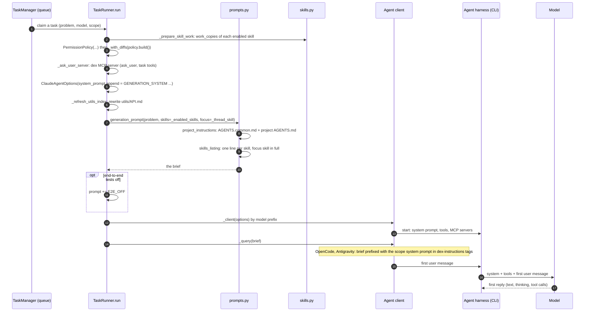

### The window at the first model call — Claude

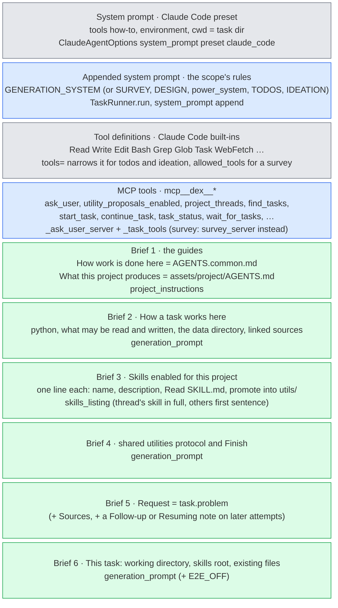

Nothing else reaches it: `setting_sources=[]` keeps the CLI from reading any
`CLAUDE.md`, `.claude/` settings or Claude skills on the machine, so the brief
is the whole spec.

The brief runs **from what every task of a thread shares to what is this
task's alone** (the comment above the return in `generation_prompt`). Blocks
1–5 up to `# Request` are word for word the same for every task of a thread —
the skills are written against `<skills>` and that root is named only in
block 6 — so a model server's prompt cache reads them once per thread, not
once per task.

### The window at the first model call — Codex, OpenCode, Antigravity

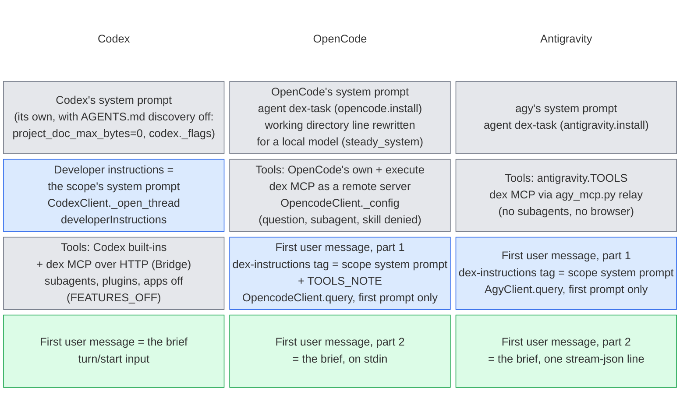

The difference that matters: **only Claude and Codex put dex's rules in the
system position.** OpenCode and `agy` keep their own system prompt (it is what
teaches the model their tools), so dex's part rides in front of the first user
message, once, and is never re-sent: `_first_prompt` is false for a session
that resumes.

### What each scope's brief is

| Scope | Appended system prompt | Brief |
|---|---|---|
| package task | `GENERATION_SYSTEM` | `generation_prompt` (above) |
| project-wide task | `GENERATION_SYSTEM` | `generation_prompt(project_wide=True)`: guide, request, "maintenance pass", finish |
| survey | `SURVEY_SYSTEM` | `survey_prompt`; tools held to `surveyor.TOOL_NAMES` + `ask_user`, always on Claude |
| design turn | `DESIGN_SYSTEM` | `design_prompt`: guide, chat history, message |
| power task | `power_system` | `power_prompt`: request and where things are, no project guide |
| todos split | `TODOS_SYSTEM` | `todos_prompt`, tools `Read Grep Glob Bash` |
| ideation | `IDEATION_SYSTEM` | `ideation_prompt` |

---

## 2. A session resumes

A run resumes a session when `task.resumed_from` holds a session id. Five
paths set it, and each sends something different as the first new turn:

| Path | Sets `resumed_from` | First new user turn |
|---|---|---|
| Pause for capacity, server restart, Resume in place | `TaskManager.pause` / `resume_paused` / `resume_in_place` (`src/dex/queue.py`) | the **whole brief again** (same `problem`) |
| Resume (a new attempt of a stopped task) | `TaskManager.resume` | the brief, with a `## Resuming` note appended to the request |
| Follow-up, Compact off | `TaskManager.deliver_messages` | the brief, with `## Follow-up` and the operator's notes |
| Follow-up, Compact on (`compact_follow_ups`) | not set: a **fresh session** | the brief, with `## Follow-up` holding the previous summary (section 5) |
| Woken after `wait_for_tasks` | `Dependencies` (deps.py) | only `wake_note`: how the waited-on tasks went |

### Who adds what

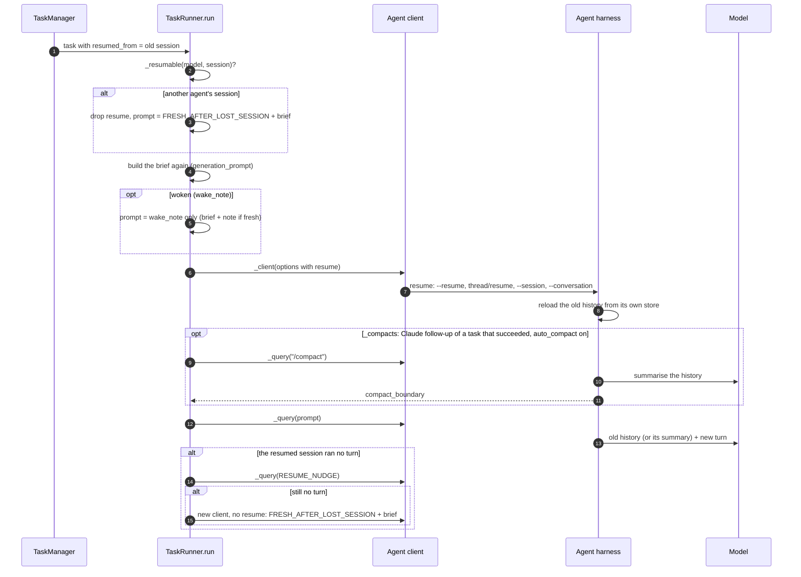

### The window after a resume

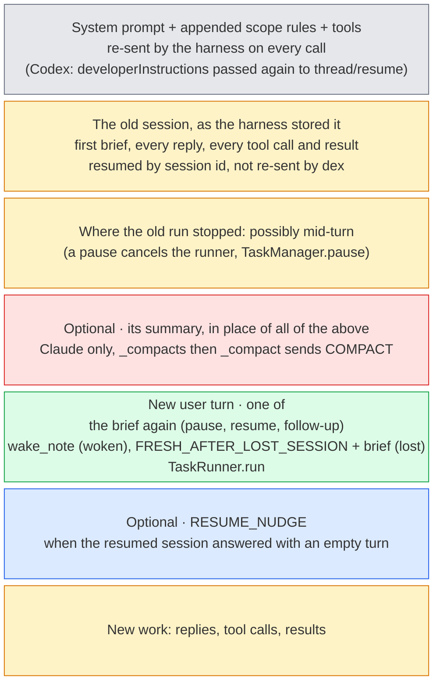

On OpenCode and Antigravity `dex-instructions` is not sent again on a resume
(`_first_prompt = not options.resume`): the copy from the session's first
message is still in the history.

### Messages that arrive while a run goes

Two more user turns can join a running session, both from
`TaskRunner._converse`:

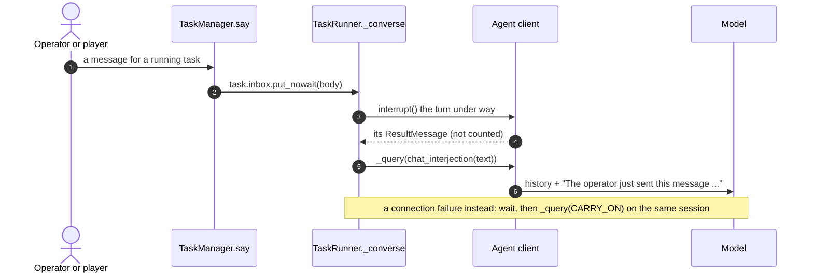

A message typed after the last turn ended is kept (`TaskMessageStore.add`) and
starts the next follow-up attempt instead.

---

## 3. Skills pulled in mid-run

A skill enters the window in two tiers (the comment above `skills_listing` in
`generation_prompt`): **always** its one line in the brief, **on demand** its
`SKILL.md`, read with an ordinary file read once the agent decides it needs
it. dex never injects a `SKILL.md` itself, and no agent's own skill system is
used: Claude's CLI loads none (`setting_sources=[]`), OpenCode's `skill` tool
is denied (`opencode.REFUSED`), Codex's skills are not registered (design 29).

### Who adds what

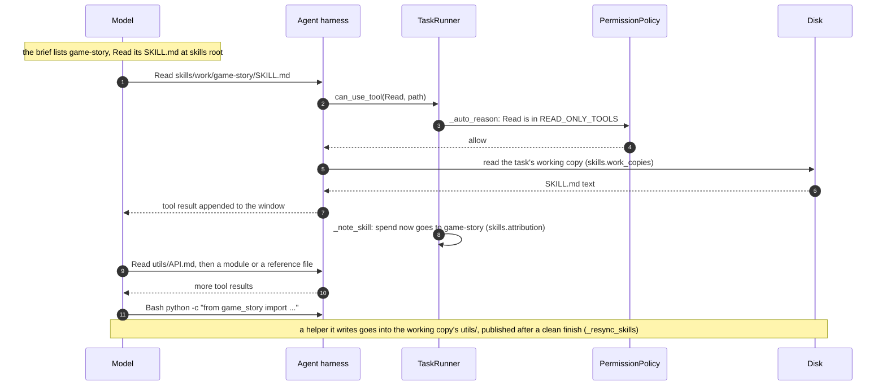

### The window after reading a skill

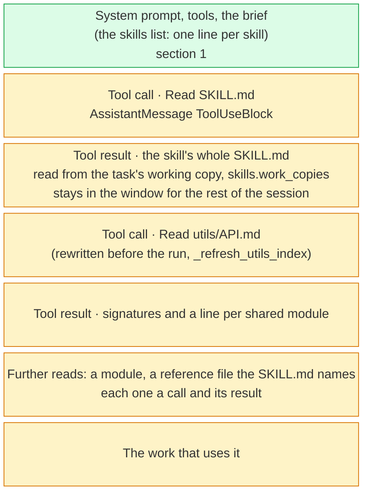

A skill's text costs its full size once it is read, and stays until the
session is compacted (section 5). The thread's own skill is described in full
in the listing (`skills_listing(focus=...)`), with the skills its `SKILL.md`
names, so the agent usually needs no extra read to find it.

---

## 4. How a tool call runs

### Claude

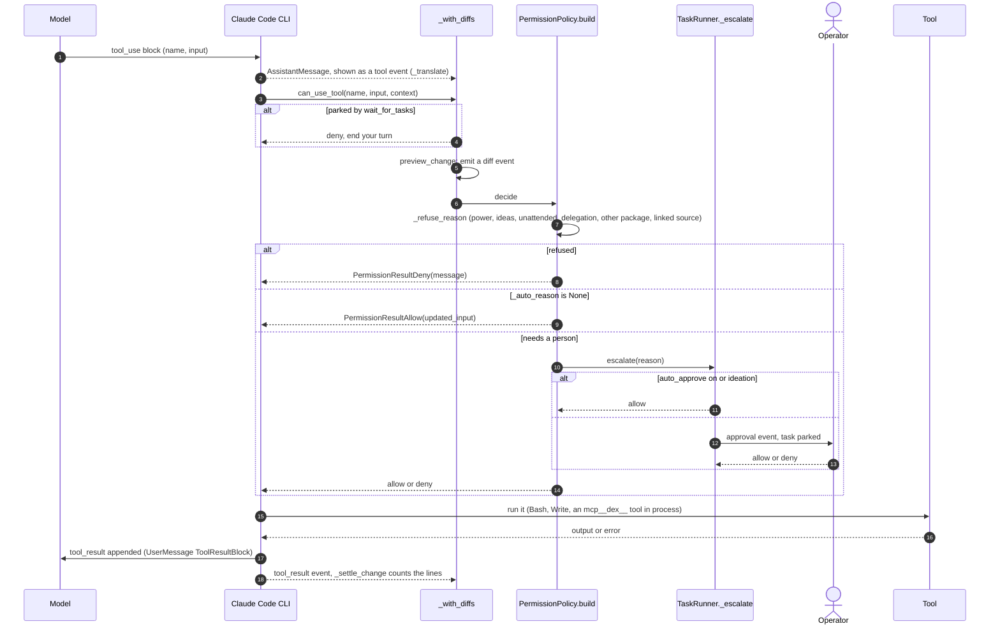

A denial is a tool result too: the model reads the policy's message
(`PermissionResultDeny.message`) as the call's output and goes on.
`mcp__dex__ask_user` is allowed outright and then holds the call open
(`_park`) until the operator answers, so the answer comes back as its result.

### Codex, OpenCode, Antigravity: the same policy behind a gate

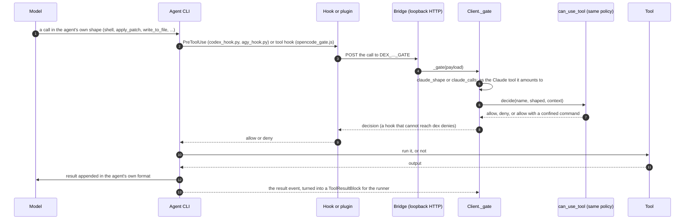

dex's MCP tools reach these agents over the same Bridge
(`antigravity.Bridge`), served from the in-process server a Claude run gets.
OpenCode calls them inside its `execute` code tool, each inner call gated on
its own (`OpencodeClient._gate`, `CODE_TOOL`).

### The window after tool calls

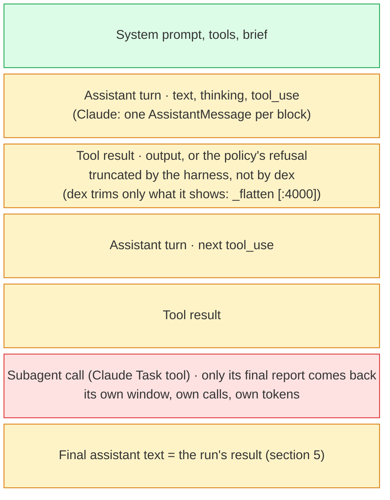

### Subagents

Only Claude has them in a dex task. Its `Task` tool has no auto-approval rule,
so it escalates (`_auto_reason`: "has no auto-approval rule"), which
auto-approve turns into an allow. The subagent runs in a **window of its own**:

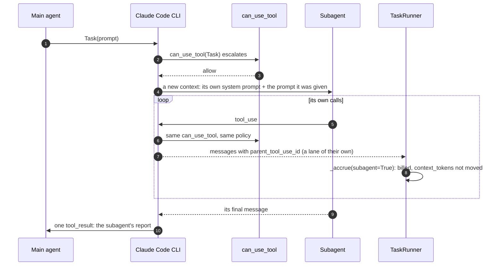

The others have none: OpenCode's `subagent` is denied (`REFUSED`, and
`deny` in the `dex-task` agent), Codex's are switched off (`multi_agent` in
`FEATURES_OFF`, and a message on another thread is dropped), `agy` is not
given them (`antigravity.TOOLS`).

---

## 5. Summaries and compaction

Four mechanisms shrink or replace a window. dex drives the first three; the
fourth is the agent's own.

| Mechanism | Who | When | What replaces the history |
|---|---|---|---|
| Closing summary | dex, every run | each `ResultMessage` | nothing yet: it is stored as the `result` event's `summary` |
| Fresh session from the summary | dex, `compact_follow_ups` on | a follow-up to a task that **succeeded** | the stored summary, quoted in the new brief (`deliver_messages`) |
| `/compact` before a follow-up | dex, `auto_compact` on | a follow-up resuming a successful task's session, **Claude only** | Claude Code's own summary (`_compact`) |
| Auto-compaction | the agent's harness | the window is nearly full | the harness's own summary, mid-turn |

### The closing summary and where it is reused

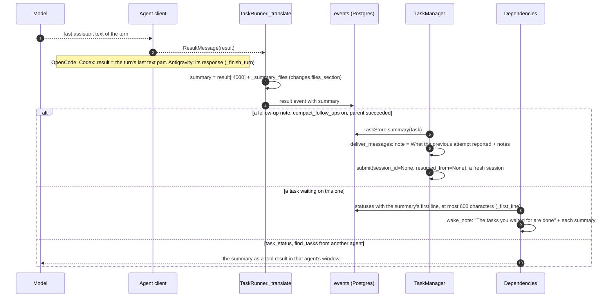

### Fresh session from a summary (Compact on)

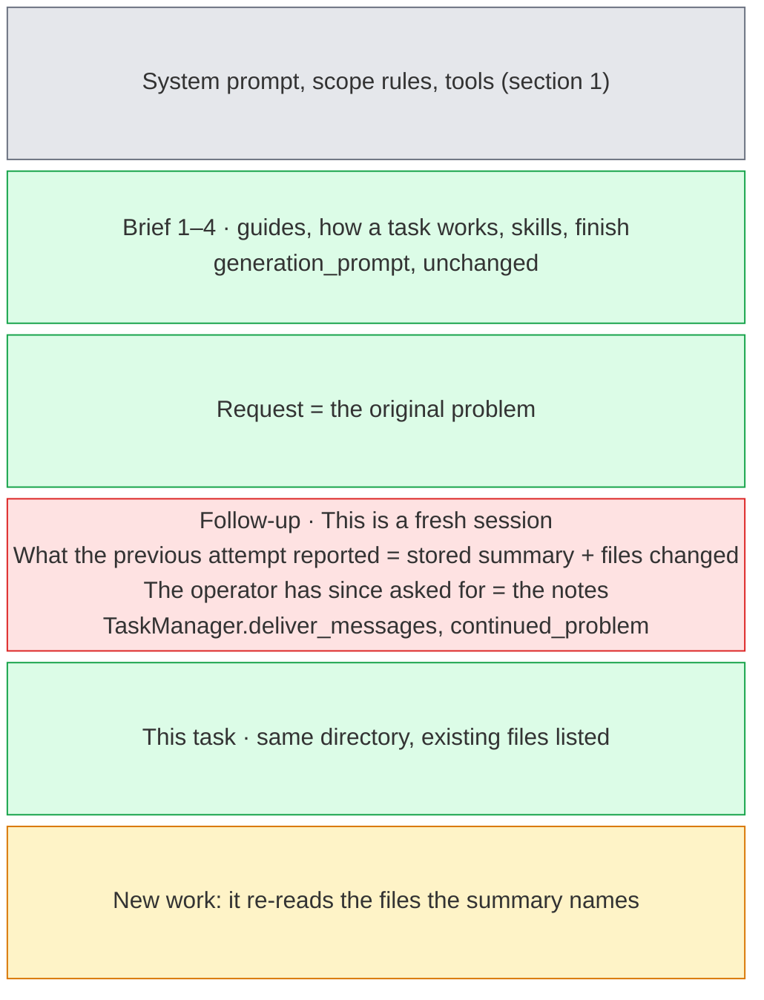

This works the same on every agent: it is only text in a new brief.

### `/compact` before a follow-up (Claude only)

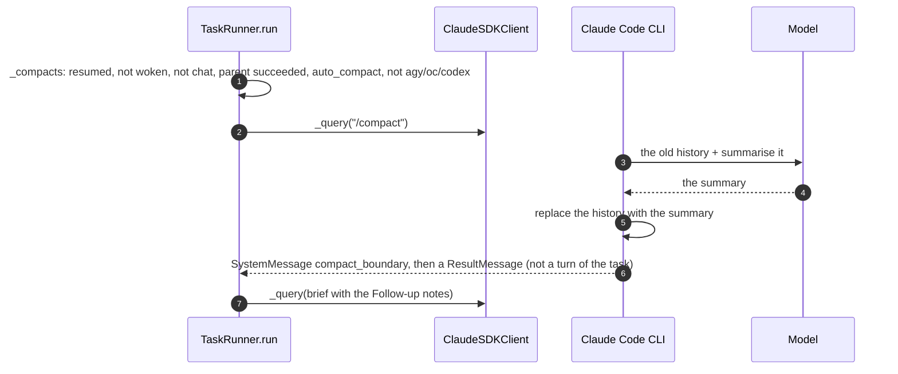

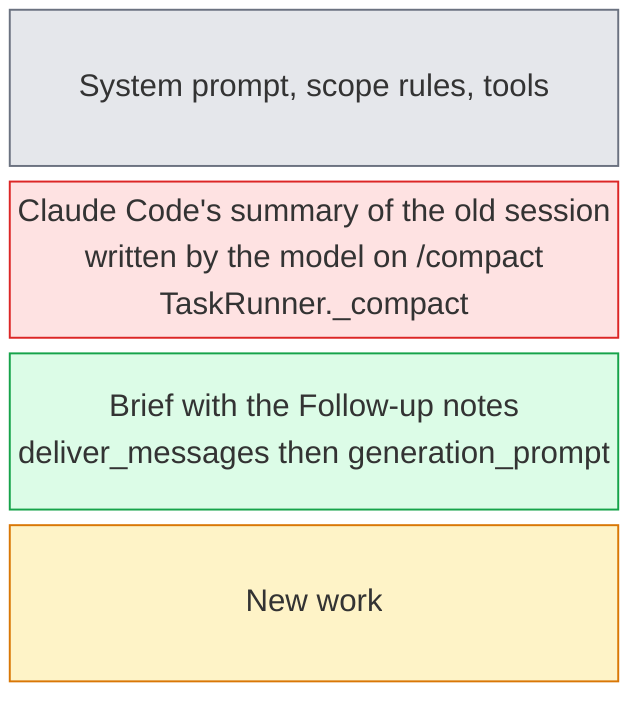

The two settings do not stack: with `compact_follow_ups` on, a successful
parent's follow-up has no session to resume (`resumed_from=None`), so
`_compacts` is false and nothing is sent.

### The agent compacting itself when the window fills

Every harness dex runs keeps its own session and compacts it on its own when
the window is nearly full. dex neither starts nor configures it, beyond the
window size it declares for a local model:

| Agent | Threshold | What dex sees |
|---|---|---|
| Claude | Claude Code's auto-compact, near the model's window | a `compact_boundary` system message, ignored outside `_compact` (`_translate` returns on every other subtype) |
| OpenCode | near the model's `limit.context`: the Go plan's, or a local entry's `context` in `local-models.json` (default 65,536, `local_provider`) | a model request with no usage of its own (`SystemMessage model_request` from the relay, design 09), then `context_tokens` falling on the next call |
| Codex | the thread compacts itself when full (design 29) | only the falling token counts |
| Antigravity | `agy`'s own | only the falling token counts |

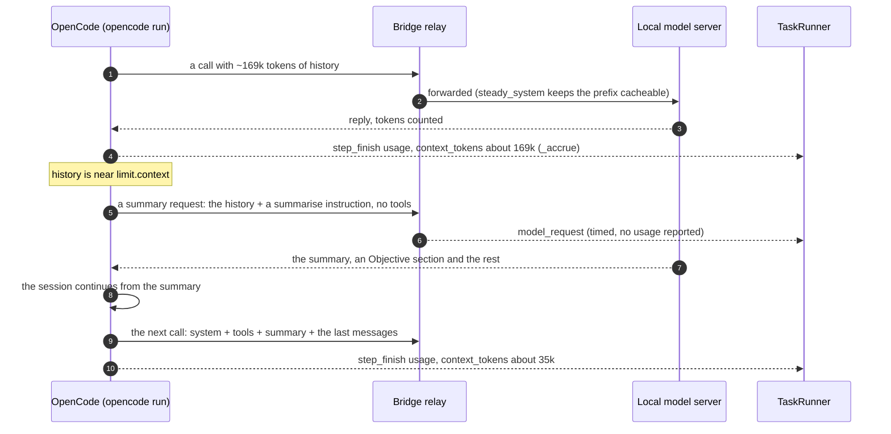

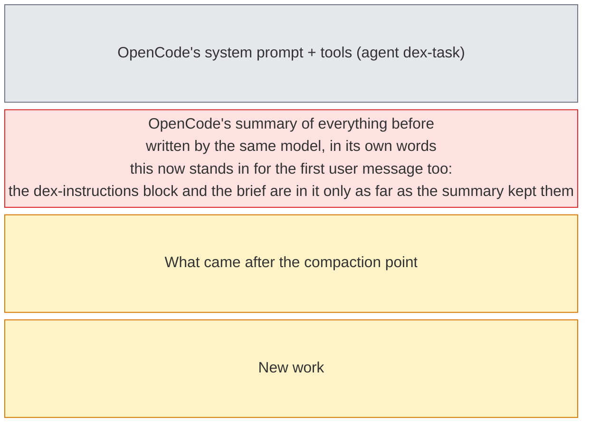

That last block is the reason it matters most on OpenCode and Antigravity:
there, dex's rules live in the first user message, which compaction folds into
the summary. On Claude and Codex they are in the system position and survive
it whole.

---

## Improvement opportunities

- **A resume re-sends the whole brief.** `TaskRunner.run` builds the brief and
  sends it as the first new turn whenever the session is resumed (pause,
  restart, Resume in place, follow-up), so the session holds it twice — on a
  local model with a 64k window that is a large share of it. A resumed session
  needs only what changed: the note, or `RESUME_NUDGE`.
- **Compaction by the agent is invisible.** `compact_boundary` outside
  `_compact`, and OpenCode's summary request, raise no event; the task panel
  shows only the context number falling. One `text` event ("the agent
  compacted its context") would make the moment the user saw explainable
  without reading token counts.
- **dex's rules can be summarised away on OpenCode and Antigravity.** They
  travel in the first user message (`dex-instructions`), which the agent's own
  compaction rewrites. Re-sending them after a compaction, or OpenCode's
  `--agent` prompt carrying them, would keep them verbatim.
- **Two settings, two meanings of "compact".** `auto_compact` (Claude
  `/compact` on the resumed session) and `compact_follow_ups` (a fresh session
  from the stored summary) sound alike and do different things. The second
  works for every agent; the first could go.
- **Design 03 lags the code.** Its "Auto-compact for follow-ups" section lists
  Antigravity and OpenCode as resuming whole; `_compacts` excludes Codex too.
- **No size is shown per block.** Nothing measures how many tokens the guide,
  the skills list or a `SKILL.md` take; `context_tokens` is a single total.
  Counting the brief's sections when it is built would show which block to
  shrink.
